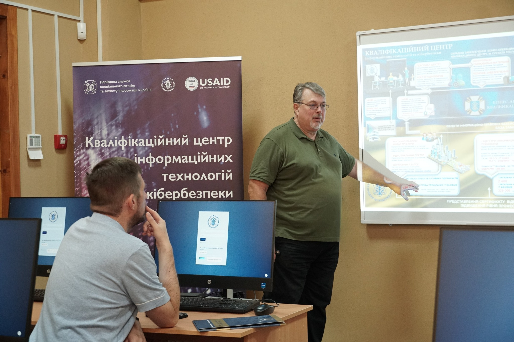
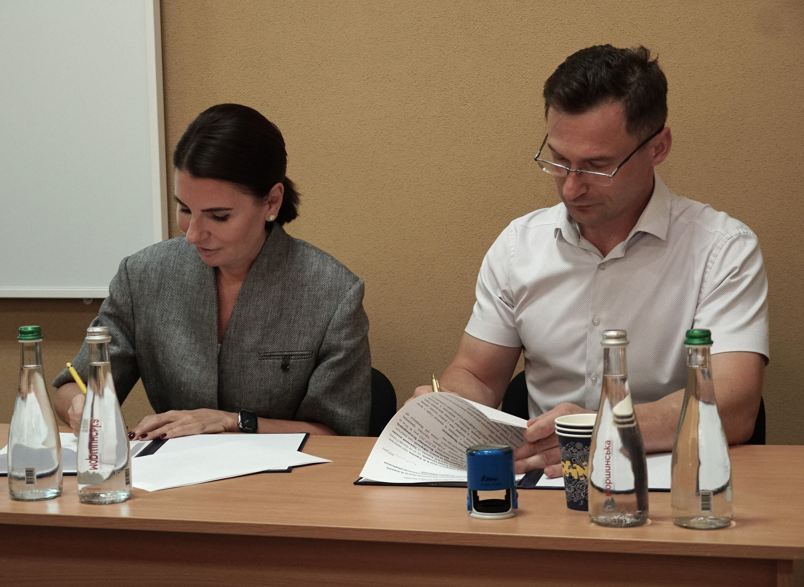

Head of the State Research Institute of Cybersecurity Technologies and Information Protection of the State Special Communications Service Volodymyr Pavlikov and Rector of V. N. Karazin Kharkiv National University Tetyana Kaganovska signed a Memorandum of Cooperation and Interaction in the Field of Cybersecurity and Information Protection.

The document, in particular, provides for the implementation of a system of professional standardization and certification of personnel in accordance with professional qualifications and corresponding positions. This concerns the creation and further operation of a training center for cybersecurity specialists based on the V. N. Karazin KhNU, where they will be able to undergo training, acquire knowledge and acquire skills and abilities for further passing the integrated qualification exam at the Qualification Center for Information Technologies and Cybersecurity, which operates as part of the State Research Institute of Cybersecurity Technologies and Information Protection of the State Special Communications Service, headed by Doctor of Technical Sciences, Professor Volodymyr Pavlikov.

During the meeting, the scientific secretary of the State Research Institute of Cybersecurity Technologies and Information Protection of the State Special Communications Service, Oleksandr Yudin, spoke in detail about the work of the Qualification Center and the procedure for passing certification of specialists according to professional qualifications (positions). He emphasized that the Qualification Center is implementing a modern system of professional standardization and certification of cyber specialists, which will make it possible to coordinate the knowledge, skills and competencies of cybersecurity specialists with the modern needs of the labor market in Ukraine.

At the same time, Oleksandr Yudin drew attention to the importance of thorough preparation and specialized training before passing the qualifying exam in the field of cybersecurity and information protection, which can be taken at partner training centers of leading higher education institutions. In addition to the V.N. Karazin KhNU, the Qualification Center of the State Special Communications Service is also working to create a system of regional training centers according to their accreditation profile and basic educational programs in order to organize high-quality educational courses (trainings) in accordance with professional standards and their qualifications, namely: at the National Aerospace University "Kharkiv Aviation Institute", PJSC "Diprozvyazok", the Institute of Modeling Problems in Energy named after G. E. Pukhov, the National Academy of the Security Service of Ukraine, the Taras Shevchenko Kyiv National University, etc. In total, 14 such memorandums of cooperation and interaction have already been signed.

In the near future, it is planned to develop regional training centers in cooperation with the Qualification Center of the State Special Communications Service with the Ivano-Frankivsk National Technical University of Oil and Gas and the Vasyl Stefanyk Carpathian National University.

The only Qualification Center for Information Technologies and Cybersecurity in Ukraine was opened in June 2023 on the basis of the State Service for Special Communications and Information Protection of Ukraine. The Center was established within the framework of the State Service for Special Communications Project to create a unified system of professional standardization and certification of personnel in the field of cybersecurity and information protection, as well as to develop and implement the National (industry) Qualification Framework for Cybersecurity of Ukraine.

