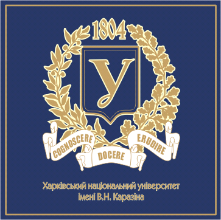
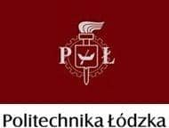

For our university and the entire academic community, hosting this forum for the twelfth consecutive year is a testament to the resilience of Ukrainian science and its deep integration into the global research community.

​Organizers and International Partnerships
This year’s conference brings together leading scientific schools and institutions:
• V. N. Karazin Kharkiv National University;
• The Coordination Council and the Northeast Coordination Scientific Center of the National Academy of Sciences of Ukraine on Artificial Intelligence;
• Lodz University of Technology (Poland);
• Max Planck Institute for Microstructure Physics (Germany).

​The Program Committee, chaired by Corresponding Member of the National Academy of Sciences of Ukraine, Professor Serhii Vsevolodovych Yakovlev, brings together leading scientists from Ukraine, Poland, Germany, the United Kingdom, Italy, and Canada.

The conference title reflects a major trend in modern science: today’s most significant breakthroughs arise not within isolated disciplines, but at their intersections.

The ITMD-2026 program covers four fundamental areas:
1\) Artificial intelligence systems and intelligent data analysis.
2\) Digital signal processing.
3\) Cybersecurity and software quality assurance.
4\) Robotics and the Internet of Things (IoT).

[Conference program](https://drive.google.com/file/d/1T-0onxx-C-Mf9VZkyk2ld06MfiIGoeJo/view?usp=sharing)

