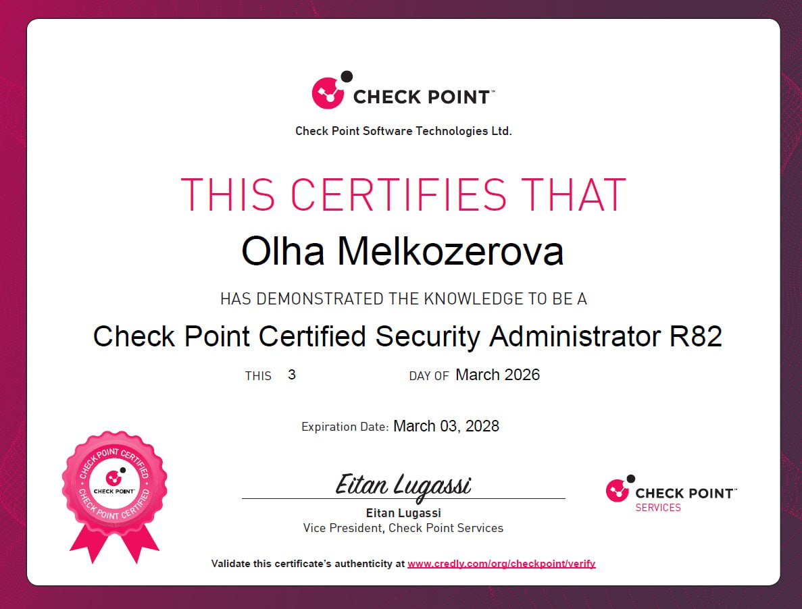

The Department of Cybersecurity of Information Systems, Networks and Technologies continues its cooperation with Check Point under the Secure Academy Program agreement. This program provides lecturers, PhD students, and students with opportunities to gain real-world practical experience, develop professional skills, and enhance their qualifications in the field of cybersecurity.

During the 2025–2026 academic year, the department expanded the program and introduced the following courses under this agreement:

* Check Point Certified Security Administrator R82 (March 2026);
* Check Point Certified Security Expert R81 (November 2025);
* Check Point Certified Threat Prevention Specialist (May 2026).

Each of these courses includes both theoretical and practical components aimed at familiarizing participants with the application of modern methods, tools, and technologies for computer network protection. Topics covered include the use of firewalls and the creation of security policies for filtering unwanted or malicious traffic from web applications and services, implementation of Network Address Translation (NAT) for IP address concealment or the use of private IP addresses, VPN configuration for secure remote access to corporate resources, and other cybersecurity technologies.

The Security Administrator and Security Expert courses serve as foundational courses providing a general introduction to the Check Point environment. In contrast, the third course, Threat Prevention Specialist, focuses on:

* the use of the highly popular Intrusion Prevention System (IPS), which includes approximately 16,000 built-in and continuously updated protection mechanisms against publicly known and standardized vulnerabilities listed in the Common Vulnerabilities and Exposures (CVE) database;
* the application of pre-infection and post-infection protection technologies, including Antivirus and Anti-Bot solutions.

The department will continue its efforts to expand the range of available courses and deploy laboratory environments based on virtual machines running Check Point, Windows, and Kali Linux. These environments will provide students with opportunities to develop practical skills in computer network protection and cybersecurity operations.

