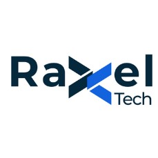

Do you dream of creating smart machines? Do you want to understand how autopilot works, or do you just love to code and solder? We invite schoolchildren and students to the large-scale Karazin.Robotics competition! This is your chance to improve your Hard Skills, immerse yourself in the atmosphere of university drive and compete for the title of the best roboticist.

# **Event calendar**

The competition will be held in three stages:

**STAGE 1: Qualifying (Online)** — January – March 24, 2026

What we do: Watch workshops, complete tasks at home, register.

**STAGE 2: Robotics School** — March 24 – 30, 2026

What we do: Intensive training, analysis of electronics and sensors.

**STAGE 3: Grand Finale** — April 11, 2026

What we do: We launch robots into the maze and determine the winners.

# **Stage details and tasks**

### **STAGE 1. Qualifying (Online)**

**Deadline for submitting solutions:** March 24, 2026.

We have prepared two video workshops for you. Your goal is to watch lectures and complete tasks that will become your "ticket" to the next stage.

**Attention!** The tasks are unique for each participant. The input parameters are tied to your date of birth (day and month).

**Important: You can submit the form at any stage of completion.**

##### **Workshop 1.1: Introduction to Arduino (Emulator)**

Learn to create a "brain" for a robot without leaving home.

<NewsYouTube id="https://youtu.be/pusEv7w7i7Q" title="Karazin Robotis 2026 workshops 01" />

1. **Watch a video lecture:** about working with the Arduino emulator
2. **Assemble a circuit:** Create a circuit with an LED.
3. **Write the code:** Implement brightness control and a logical trigger condition (for example, turning on at a certain value).
4. **Submit results:** Complete the form with your solution

[Submit work](https://csai.karazin.ua/event-registration?target=robotics2026)

##### **Workshop 1.2: Robotics Physics**

A real engineer must understand the physics of motion.

<NewsYouTube title="Karazin Robotis 2026 workshops 02" id="https://youtu.be/MUPHdWrLa5E" />

1. **Watch a video lecture:** about the mechanics of a robot machine.
2. **Solve the problem:** Calculate whether the engine power and gear ratio of the gearbox are enough to pull the load.
3. **Uniqueness:** The mass of the load or the parameters of the engine depend on the month of your birth.
4. **Submit results:** Complete the form with your solution

[Submit work](https://csai.karazin.ua/event-registration?target=robotics2026)

**How to submit the work?** Fill out the Google form at the link below. You will need:

* A screenshot of the emulator screen for the first task.
* A photo of the solution to the problem on paper for the second task.
* Your contact details so that we can invite you to participate in the Robotics School and the final.

<NewsPicture src="/src/assets/qr-code_karazin_robotics_extended.png" alt="Karazin.Robotics: Submit work" />

[Submit work](https://csai.karazin.ua/event-registration?target=robotics2026)

### **STAGE 2. Robotics School (March 24-30)**

Those who successfully pass the selection process are admitted to our School. This is a series of lectures and demonstrations where we will complete the theory.

**Venue:** Karazin Safe Space.

**Workshops will be held:** March 24, 25, 26 from 10:00 to 13:40.

**Two workshops each day:** at 10:10 and 12:00.

**Free practice:** March 28 from 10:00 to 15:00 (pre-registration required).

**Meeting point:** central entrance of the northern building of Karazin University (Svobody, 6), at 10:00.

**Bring with you:** a good mood, a desire to gain knowledge, your own laptop (optional, for convenience).

**What we will study:**

* **Control:** How to make the wheels spin at the desired speed (PWM signals).
* **Sensors:** We teach the robot to "see" walls (ultrasound), obstacles (sensors) and markings (trackers).
* **PRO level (for students):** Working with an ESP32-based camera and the basics of computer vision (Computer Vision).

### **STAGE 3. FINAL (April 11)**

<NewsPicture src="/src/assets/karazin-robotics-phase-3.png" alt="Karazin.Robitics: Stage 3" />

**Final:** The robot must autonomously navigate the maze.

[Regulations and rules of the competition](https://drive.google.com/file/d/1I-ArBB8XKo_CfWe89zzKu2RekdjJujWc/view?usp=sharing)

Time to show what you're capable of!

See you at Robofest 2026! We build the future!

.jpg>)

.jpg>)

Organizer: Educational and scientific Institute of Computer Science and Artificial Intelligence

Partners:

* Educational and scientific Institute of Computer Science and Artificial Intelligence
* Department of Computer Systems and Robotics
* Information partner INSCIENCE

* [Raxel Tech](https://www.raxeltech.com/)

Raxel Tech: [Instagram](https://www.instagram.com/raxel_tech?igsh=eWVubHFqYmM4ZTFt) \

* [Plasma-Spin-Energy](https://www.mpi-halle.mpg.de/plasma-spin-energy)

