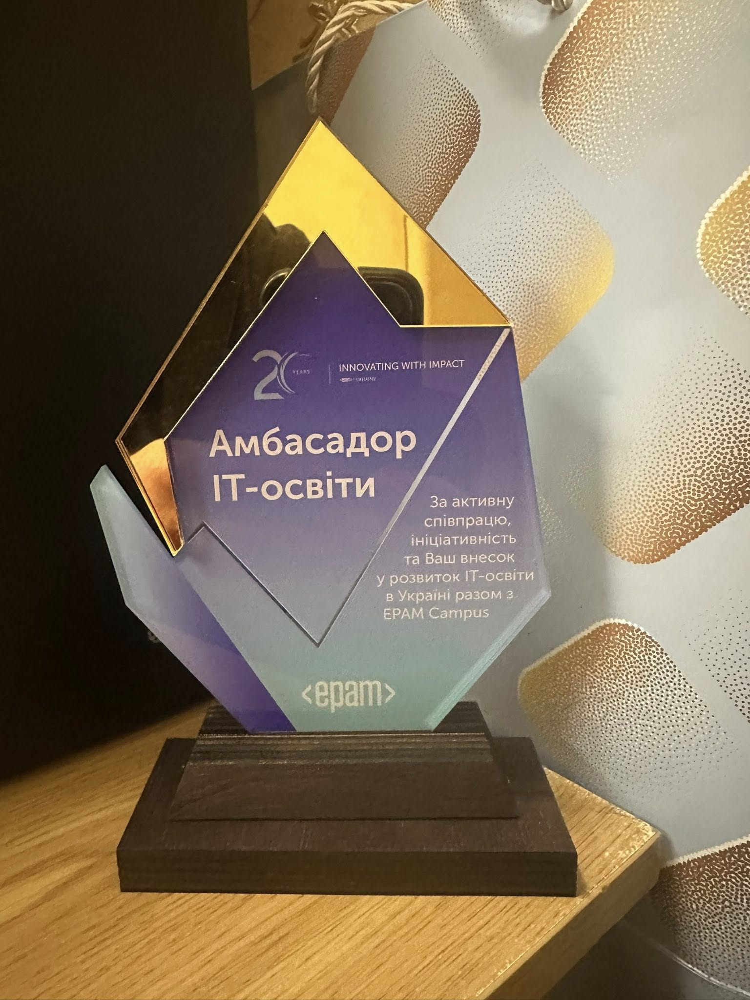

"Today, I had the honor of receiving the "IT Education Ambassador" award from EPAM Corporation. The award was presented by Ivan Mikheev, head of EPAM's educational programs in the eastern region of Ukraine.

For me, this award is not just a personal reward, but confirmation that the efforts of our team at the Institute of Computer Science and Artificial Intelligence at V. N. Karazin Kharkiv National University are moving IT education in the right direction. 

EPAM highly appreciated our achievements and contribution to the development of education, and also supported an important initiative — participation in the creation of a bomb shelter for the institute, which became a significant example of corporate social responsibility. 

EPAM is our key partner and stakeholder. When such a powerful market player notices your contribution, it gives you an incredible impetus to work even harder.

I sincerely thank EPAM Campus and Ivan Mikheev personally for their trust, support, and joint initiatives. There are even more joint projects, innovations, and opportunities for our students ahead!"

— Dmytro Uzlov, Director of the Institute of Computer Science and Artificial Intelligence.

