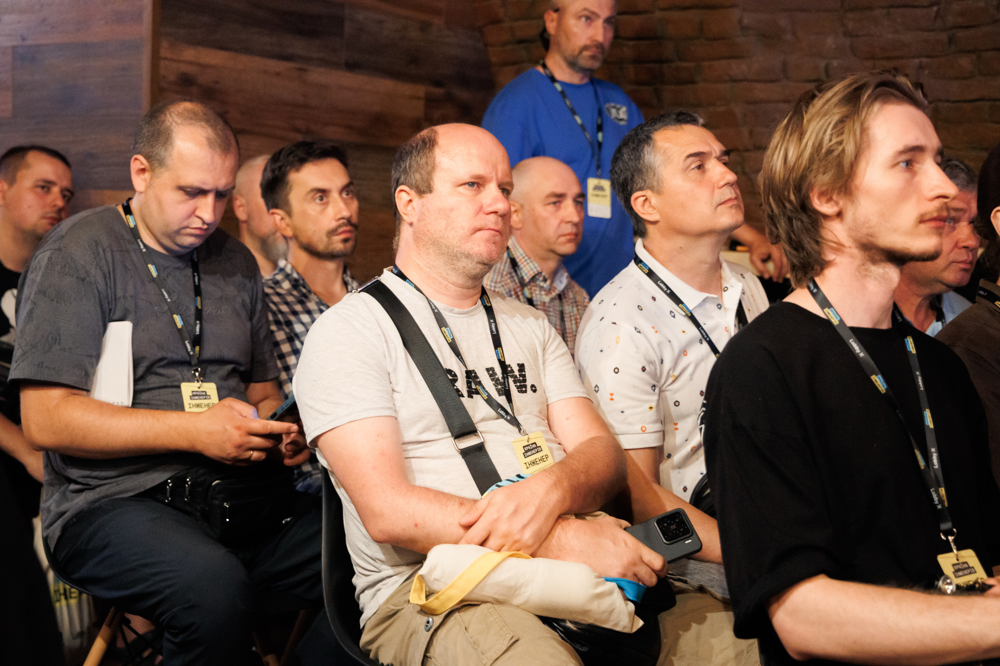

On June 13, 2026, a significant event for Ukraine’s technological and scientific community—the national gathering "Land of Engineers" ("Kraina Inzheneriv")—took place in Kharkiv. Maksym Mykhailovych Khruslov, Head of the Department of Computer Systems and Robotics at the Educational and Scientific Institute of Computer Science and Artificial Intelligence of V.N. Karazin Kharkiv National University, participated in discussions regarding the most pressing challenges in the field of engineering.

The "Land of Engineers" event aims to bring together the nation’s intellectual core—experienced engineers, scientists, and designers—to scale up \*miltech\* (military technology) solutions. During the event, participants shared their expertise and discussed the creation of practical technologies capable of fundamentally transforming the country’s defense capabilities, turning theoretical calculations into a tangible advantage on the battlefield.

A key topic of discussion was the critical shortage of qualified engineering personnel. Recent industry studies indicate that Ukraine’s defense-industrial complex is currently growing much faster than the labor market can produce new engineers. Today, 100% of defense-tech companies are planning to hire new specialists, yet they face a major obstacle: a lack of available talent.

Currently, the most in-demand roles include:

* Design engineers.
* Electronics and embedded systems engineers.
* Software developers.

In this context, the participation of representatives from the academic community—specifically from V.N. Karazin Kharkiv National University... ...at V.N. Karazin Kharkiv National University is highly relevant. Research indicates that 48% of defense companies view improved collaboration with universities as the key to solving their staffing challenges. The Department of Computer Systems and Robotics, headed by Maksym Khruslov, directly trains specialists in fields that are critically important for the sector's innovative development—ranging from automation and mechatronics to communications and artificial intelligence.

The event also featured a pitch session for innovative ideas and a demonstration of prototypes, offering the best projects the opportunity to secure funding from a grant pool of up to 100,000 USD. Ukraine already boasts strong examples of successful, world-class engineering startups that underscore our immense potential—such as Esper Bionics, which creates AI-powered robotic prosthetics, or the startup Kurs Orbital, which develops solutions for the in-orbit servicing of satellites.

Maksym Mykhailovych Khruslov’s participation in the "Country of Engineers" national series highlights the commitment of V.N. Karazin Kharkiv National University to remain at the forefront of modern technological advancements, to tailor academic curricula to real-world market demands, and to bridge the gap between fundamental science and the needs of Ukraine’s defense industry.

Lobby X [https://thelobbyx.com/](https://thelobbyx.com/)

Ministry of Defence of Ukraine [https://mod.gov.ua/](https://mod.gov.ua/)

Event website [https://miltech.thelobbyx.com/](https://miltech.thelobbyx.com/)

