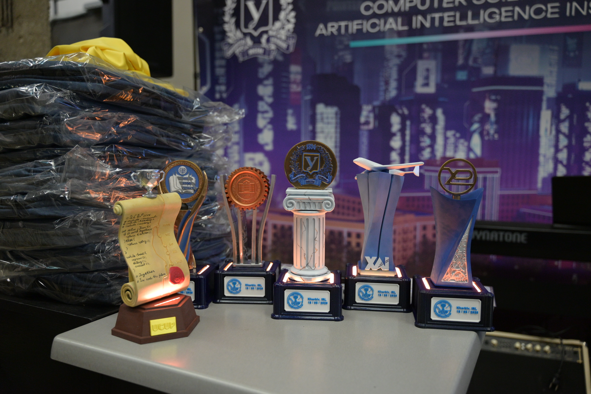

V. N. Karazin Kharkiv National University actively participated in the first large-scale interuniversity competition in programming and creative IT disciplines — the University Programming Cup 2026 (UCUP). Throughout the series of events, the university's students demonstrated a high level of preparation, technical expertise, and teamwork.

The competition took place from 17 April to 18 May 2026 in a fully offline format at secure venues provided by Kharkiv universities. Approximately 100 students, representing teams from seven higher and professional education institutions in the city, took part in the event.

### Key Events of the Season

* 19 April — Prompt Evolution (a competition in prompt engineering and working with neural networks, partnered by NEAR.AI);
* 26 April — Game Jam (a five-hour intensive competition focused on developing computer games);
* Team technical battles and esports tournaments;
* 16–17 May — the Grand Final held in the format of a classical team algorithmic programming contest following the ICPC style (teams of three participants, five hours of competition).

### Organizers and Partners

The event was organized by V. N. Karazin Kharkiv National University, National Technical University "Kharkiv Polytechnic Institute", and the Q-Bit Youth Society. Student organizers from the participating universities also made a significant contribution to the successful implementation of the competition.

The partners of UCUP 2026 included the Kharkiv IT Cluster, NEAR.AI, Rozetka, NIX, Balex Group, and other IT companies based in Kharkiv.

### University Team Standings

1. National Technical University "Kharkiv Polytechnic Institute" (team KhPI\_Potuzhnist) — 4 gold, 5 silver, and 7 bronze medals;
2. V. N. Karazin Kharkiv National University (team AbstractTeamFactoryProvider) — 2 gold, 3 silver, and 9 bronze medals;
3. Simon Kuznets Kharkiv National University of Economics (team Hello World) — 1 gold, 1 silver, and 2 bronze medals.

Among the other distinguished teams were RedBarrel (Kharkiv Aviation Institute) and "Shaurma (with Raspberries)" (Kharkiv National University of Radio Electronics), which also earned awards during individual stages of the competition.

Detailed results are available at: [https://ucup.org.ua/standings?lang=ua](https://ucup.org.ua/standings?lang=ua)

### Results of V. N. Karazin Kharkiv National University

Our university secured second place in the overall university standings. Most of the participating teams represented the Educational and Scientific Institute of Computer Science and Artificial Intelligence.

At the same time, teams from other faculties also made a valuable contribution to Karazin University's overall success.

In addition, six student volunteers from the Institute of Computer Science and Artificial Intelligence actively participated in organizing the event.

All winners and prize recipients received certificates, gifts, and branded merchandise from the event partners.

UCUP 2026 became the first interuniversity competition series of this scale in the history of Kharkiv. The event showcased the high level of student programming, facilitated networking between universities and IT companies, and laid the foundation for future annual seasons of the competition.

The closing ceremony took place on 18 May 2026 at the YermilovCentre Art Space.

