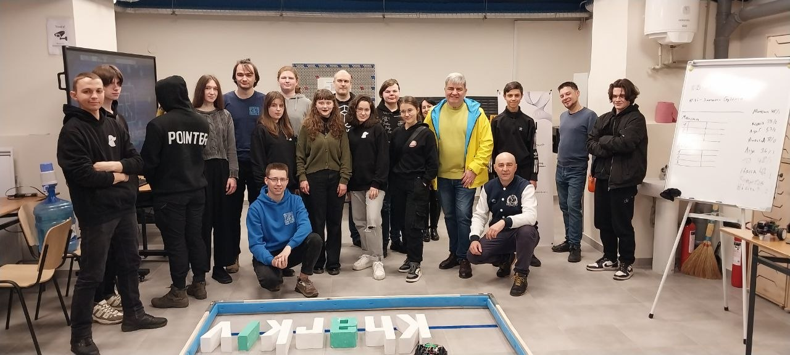
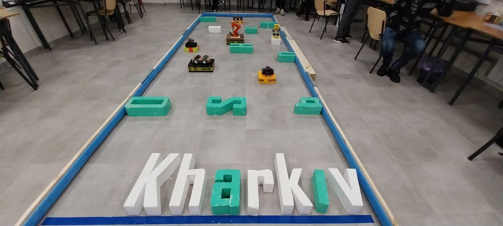
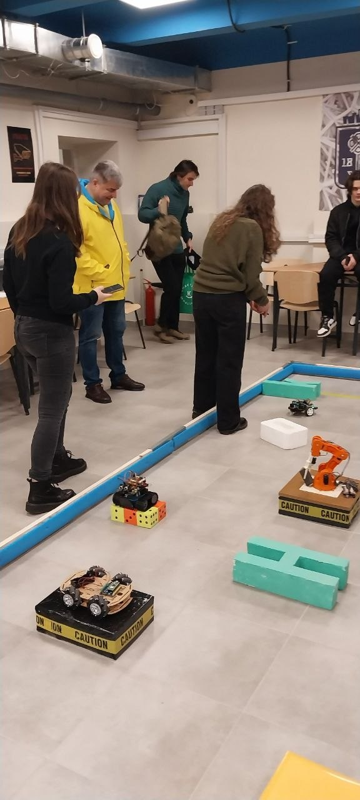
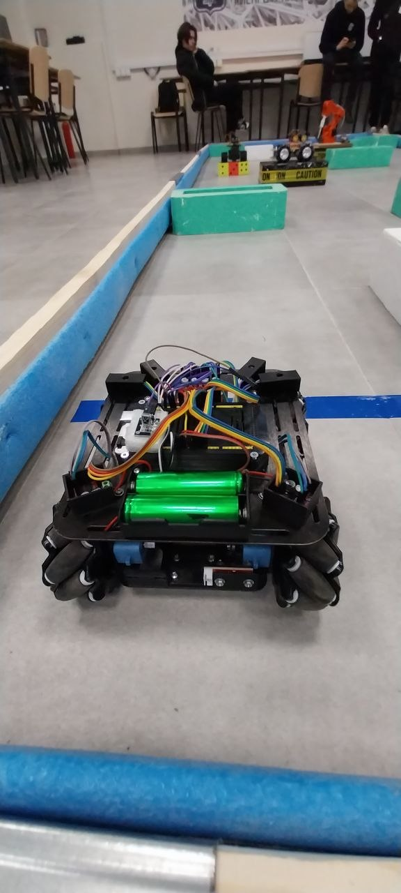
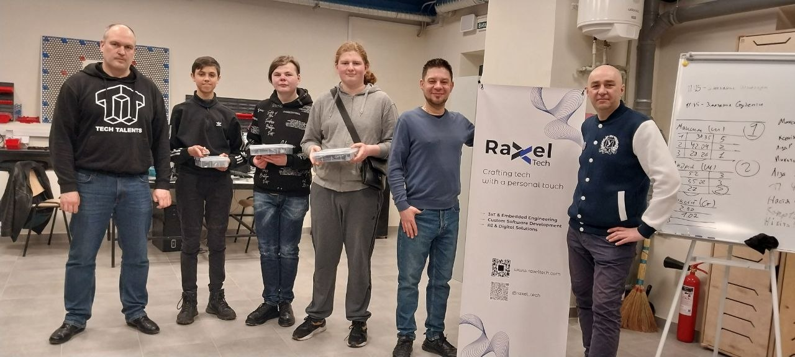
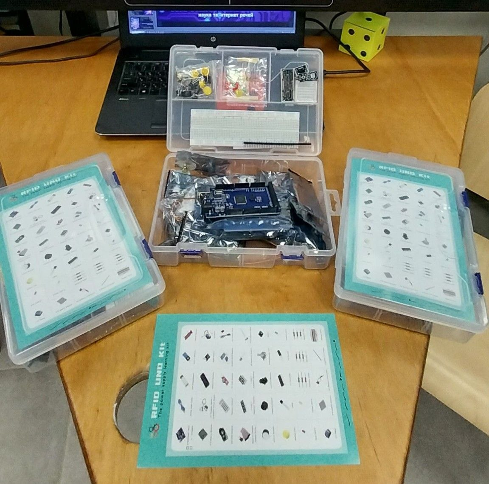

On April 11, 2026, the final of the open **Karazin.Robotics** tournament took place in the safe space of V. N. Karazin Kharkiv National University. The event brought together talented young people passionate about robotics, programming, and modern technologies.

The tournament was officially opened by the Director of the Institute, Dmytro Uzlov, and the Head of the Department of Computer Systems and Robotics, Maksym Khruslov, who wished the participants inspiration, fair competition, and bright victories.

The tournament consisted of two stages. In the first stage, school students demonstrated their skills by controlling robotic cars based on Arduino Mega using an infrared remote control, trying to complete a complex maze as quickly as possible. The atmosphere was intense, as every second mattered. The results of the training attempts were announced by the Head of the Jury, Deputy Director of the Institute, Oleksii Turuta.

The second stage brought together university students, who demonstrated deeper knowledge in programming and automation by developing algorithms for the autonomous movement of robotic cars. The participants showed a high level of preparation, engineering thinking, and a creative approach to solving technical problems.

According to the results of the competition, the winners were:

* **among school students:**
  1st place — Maksym Berestrovskyi
  2nd place — Andrii Tsurkov
* **among university students:**
  1st place — Oleksii Kochesokov

All winners and prize-winners received valuable gifts from the IT company Raxel Tech.

The **Karazin.Robotics** tournament once again proved that modern youth have great potential in the field of technology, and such events are an important platform for developing engineering skills, exchanging experience, and inspiring future achievements.

