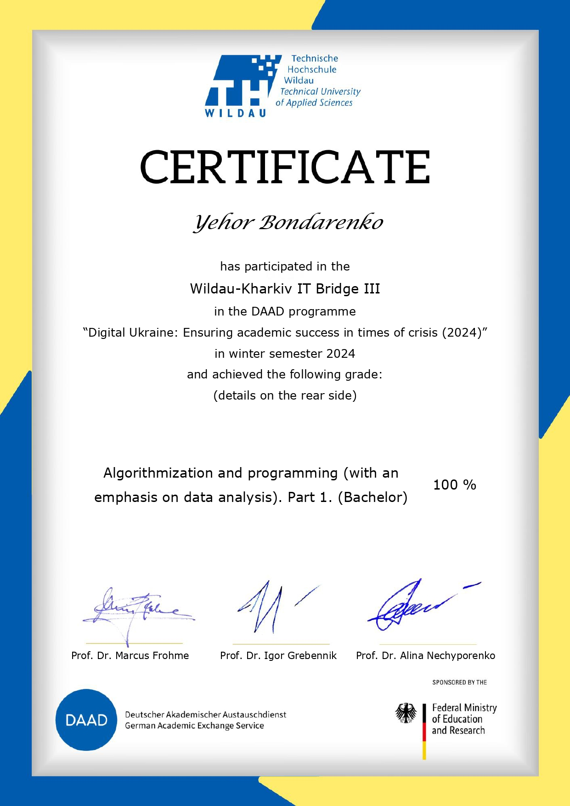
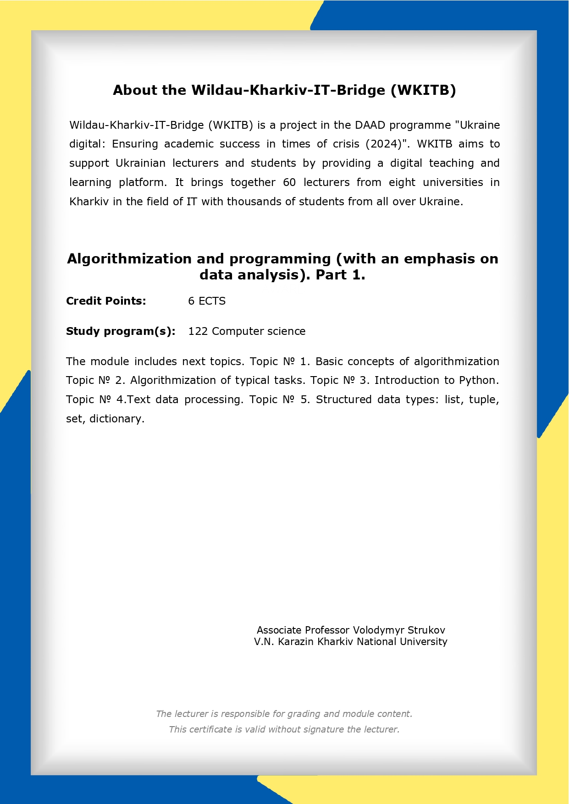

1st year students of ESI Computer Science and Artificial Intelligence, studying in the specialty 122 "Computer Science" and teachers of the Department of Mathematical Modeling and Data Analysis in the fall semester of the 2024/2025 academic year participated in the DAAD international academic exchange program "Digital Ukraine: Ensuring Academic Success in Crisis (2024)" for students and teachers of Ukrainian universities studying in the IT field within the framework of the Wildau-Kharkiv IT Bridge (WKITB) project. The project was implemented by the German academic exchange service DAAD and the Wildau University of Applied Sciences.

Students who successfully completed their studies on the project platform in the discipline "Algorithmization and Programming (Python)" received international certificates that are relevant in the countries of the European Union.

