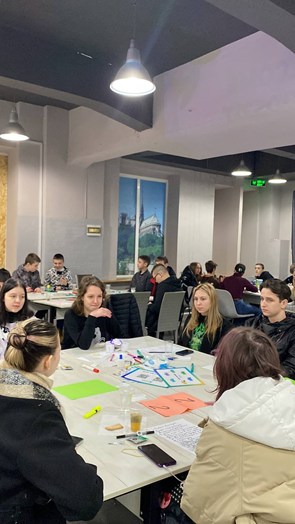
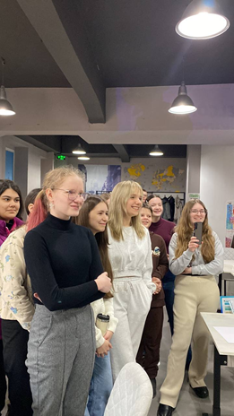

V. N. Karazin Kharkiv National University invites you to become a part of the innovative environment.

‘The Way to IT’ is your first step towards a successful career in technology. You will hear from leading industry experts, learn about the latest technologies and practices, as well as participate in interactive events that will help you choose your direction in the IT world.

The event is organised in the format of interactive lectures and workshops to help participants dive deeper into the world of IT.

The following events are waiting for you:

* Start of the journey (15.02.2025)
  Learn about the main areas of IT and the career opportunities that are open to you.
* The sorting hat (01.03.2025)
  Revealing the secrets of various IT professions, including DevOps, Software Architect, and others.
* Secrets of the Karazin castle (22.02.2025)
  Secrets of operating systems: we analyse the magic of the IT castle.
* Logicus Tower (08.03.2025)
  We explore the importance of data analysis in the world of technology.
* Mechanicus Tower (15.03.2025)
  Establishing interaction with automated systems - bringing order back to the IT castle.

Each event starts at 11:00 a.m. Kyiv time, and the theme is inspired by a magical atmosphere, which adds interactivity and engages participants in the learning process.The participants of the ‘Way to IT’ campaign will not only immerse themselves in the world of modern technologies, but will also receive valuable opportunities for further growth.

* Participant certificates confirming the acquired knowledge and skills.
* New acquaintances with like-minded people, experts and representatives of the IT industry.
* Practical skills gained during interactive events.
* Motivation and understanding of your own path in IT.
* Opportunity to join the educational programmes of the Institute of Computer Science and Artificial Intelligence.

If you are interested in technology, want to choose a future profession or expand your knowledge, these events are for you!

Choose the Institute of Computer Science and Artificial Intelligence and be one step ahead in the IT world!
