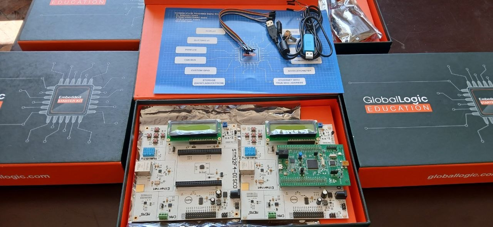
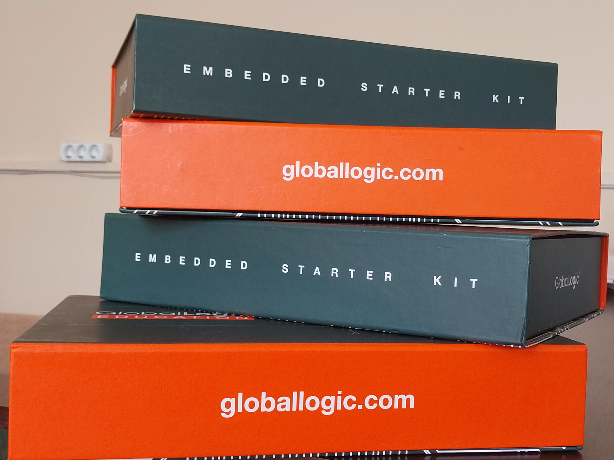

On July 19, one of the key stages of Ukraine’s 2026 admission campaign officially began — the submission of applications to higher education institutions. Over the next two weeks, prospective students will choose both their future field of study and the university that will shape their professional development in the years ahead.

In today’s rapidly evolving environment, cooperation between universities and employers has become increasingly important. Industry partners actively contribute to the development of academic programs, ensuring they reflect the current demands of the IT market. One example of such successful collaboration is the partnership between GlobalLogic Ukraine LLC and V. N. Karazin Kharkiv National University.

The company consistently supports the development of Ukrainian IT education and actively participates in preparing future professionals. As part of its cooperation with the Educational and Research Institute of Computer Science and Artificial Intelligence, GlobalLogic experts contributed to enhancing the institute’s STEM curriculum and reviewed the new master's educational and scientific program "Cyber-Physical Systems and Robotics" in the fields of Computer Engineering and Automation, Computer Technologies and Robotics.

The involvement of IT industry professionals in updating educational programs enables the university to align its teaching process with the latest requirements of the global information technology market while providing students with up-to-date knowledge and practical skills.

In addition to its expert support, the company has also contributed to strengthening the university’s material and technical resources. GlobalLogic donated modern engineering kits for the development and debugging of STM32 microcontrollers to the Educational and Research Institute. The equipment has already been integrated into the institute’s laboratory facilities and is being used by students across different years of study. In particular, the StarterKit v1.2 kits and STM32F407G-DISC1 development boards enable future engineers to conduct research, develop practical skills, and implement their own innovative projects.

Today, a successful university is defined not only by modern educational programs but also by strong partnerships with leading employers that help bridge the gap between academic education and real-world industry needs.

