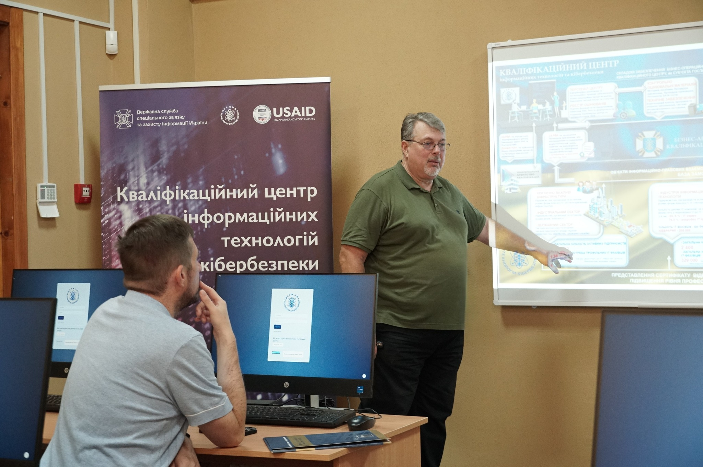
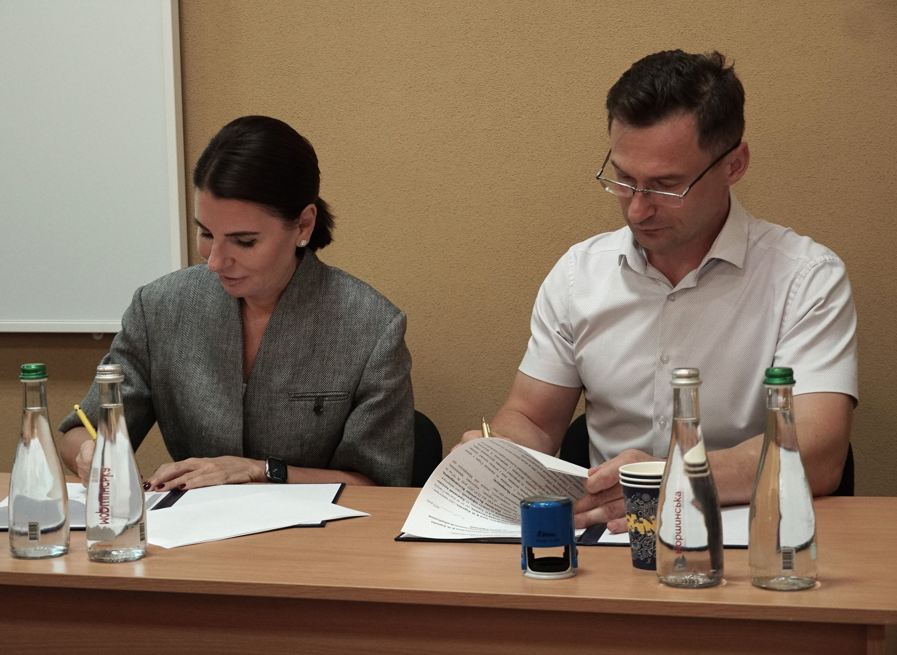

Начальник Державного науково-дослідного інституту технологій кібербезпеки та захисту інформації Держспецзв’язку Володимир Павліков та ректор Харківського національного університету ім. В. Н. Каразіна Тетяна Кагановська підписали Меморандум про співпрацю та взаємодію у сфері кібербезпеки і захисту інформації.

Документом, зокрема, передбачається впровадження системи професійної стандартизації та атестації кадрів відповідно до професійних кваліфікацій та відповідних їм посад. Ідеться про створення та подальшу діяльність на базі ХНУ імені В. Н. Каразіна тренінгового центру для фахівців із питань кібербезпеки, де вони зможуть проходити підготовку, тренінги, здобувати знання та набувати вміння і навички для подальшого складання інтегрованого кваліфікаційного іспиту в Кваліфікаційному центрі інформаційних технологій та кібербезпеки, який діє у складі ДержНДІ технологій кібербезпеки та захисту інформації Держспецзв'язку на чолі з доктором технічних наук, професором Володимиром Павліковим.

Детально про роботу Кваліфікаційного центру і процедури проходження атестації фахівців відповідно до професійних кваліфікацій (посад) розповів під час зустрічі учений секретар ДержНДІ технологій кібербезпеки та захисту інформації Держспецзв'язку Олександр Юдін. Він підкреслив, що Кваліфікаційний центр впроваджує сучасну систему професійної стандартизації та атестації кадрів кіберспеціалістів, яка дасть можливість узгодити відповідність знань, навичок та компетенцій фахівців з кібербезпеки із сучасними потребами ринку праці в Україні.

Водночас Олександр Юдін звернув увагу на важливість ґрунтовної підготовки та проведення спеціалізованих тренінгів до складання кваліфікаційного іспиту у сфері кібербезпеки та захисту інформації, яку можна пройти у партнерських тренінгових центрах провідних закладів вищої освіти. Окрім ХНУ імені В.Н.Каразіна, Кваліфікаційний центр Держспецзв’язку також проводить роботу щодо створення системи регіональних тренінгових центрів за профілем їх акредитації та базових освітніх програм з метою організації, якісних освітніх курсів (тренінгів) відповідно до професійних стандартів та їх кваліфікацій, а саме: у Національному аерокосмічному університету «Харківський авіаційний інститут», ПРАТ «Діпрозв’язок», Інституті проблем моделювання в енергетиці ім. Г. Є. Пухова, Національній академії Служби безпеки України, КНУ ім. Тараса Шевченка тощо. Загалом уже підписано 14 подібних меморандумів про співпрацю та взаємодію.

У найближчій перспективі планується розвивати регіональні тренінгові центри у взаємодії з Кваліфікаційним центром Держспецзв’язку з Івано-Франківським національним технічним університетом нафти і газу та Карпатським національним університетом імені Василя Стефаника.

Єдиний в Україні Кваліфікаційний центр інформаційних технологій та кібербезпеки відкрито у червні 2023 року на базі Державної служби спеціального зв’язку та захисту інформації України. Центр засновано в межах Проєкту Держспецзв’язку щодо створення єдиної системи професійної стандартизації та атестації кадрів у сфері кібербезпеки та захисту інформації, а також з метою розроблення та впровадження Національної (галузевої) рамки кваліфікації з кібербезпеки України.

