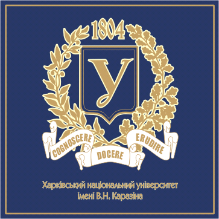
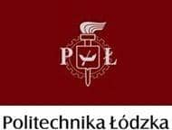

Для нашого університету та всієї академічної спільноти проведення цього форуму дванадцятий рік поспіль є свідченням незламності української науки та її глибокої інтеграції у світовий дослідницький простір.

Організатори та міжнародне партнерство
Цьогорічна конференція об’єднує провідні наукові школи та інституції:
• Харківський національний університет імені В. Н. Каразіна;
• Координаційну раду та Північно-Східний координаційний науковий центр НАН України з питань штучного інтелекту;
• Лодзький технічний університет (Польща);
• Інститут фізики мікроструктур імені Макса Планка (Німеччина).

Програмний комітет, який очолює член-кореспондент НАН України, професор Сергій Всеволодович Яковлєв, об’єднує провідних учених із України, Польщі, Німеччини, Великої Британії, Італії та Канади.

Назва конференції відображає головний тренд сучасної науки: найвагоміші прориви сьогодні народжуються не всередині ізольованих дисциплін, а на їхньому перетині.

Програма ІТМД-2026 охоплює чотири фундаментальні напрями:
1\) Системи штучного інтелекту та інтелектуальний аналіз даних.
2\) Цифрова обробка сигналів.
3\) Кібербезпека та забезпечення якості програмних систем.
4\) Робототехніка та інтернет речей (IoT).

[Програма конференції](https://drive.google.com/file/d/1T-0onxx-C-Mf9VZkyk2ld06MfiIGoeJo/view?usp=sharing)

