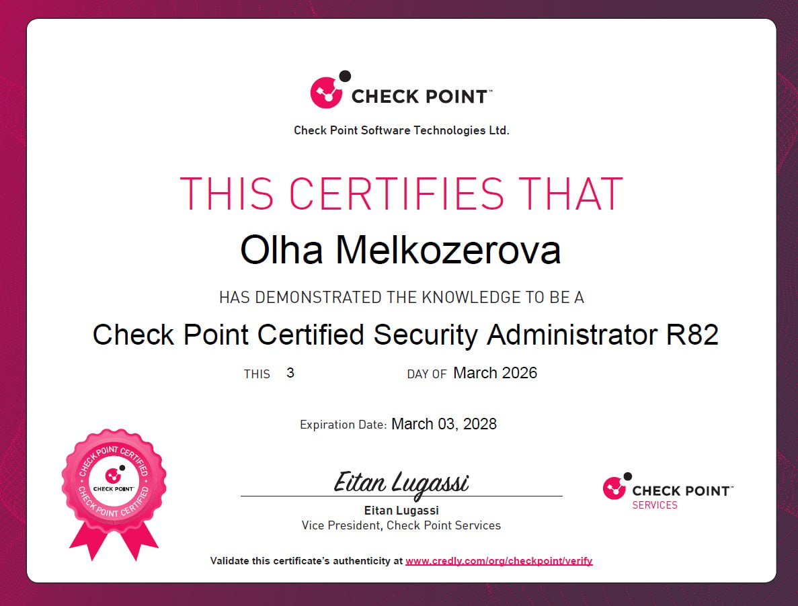

Кафедра Кібербезпеки інформаційних систем, мереж і технологій продовжує співпрацювати з компанією Check Point у рамках угоди про програму Secure Academy. Програма надає можливість отримати реальний практичний досвід, навички та підвищення кваліфікації у сфері Кіберзахисту викладачам, аспірантам і студентам. За цей навчальний 2025-2026 рік кафедра забезпечила розширення програми та додала курси за цією угодою: 

* Check point certified security administrator R82 (березень 2026), 
* Check point certified security expert R81 (листопад 2025), 
* Check Point certified thread prevention specialist (травень 2026). 

Кожен з цих курсів має теоретичну та практичну частини ознайомлення з можливостями застосування сучасних методів, засобів і технологій захисту комп’ютерних мереж: мережевих екранів із створенням політик безпеки з фільтрацією небажаного або зловмисного трафіку від веб-додатків і застосунків, методів трансляції IP адреси для її приховування або використання локальних IP адрес, налаштування VPN для віддаленої роботи з корпоративними ресурсами тощо.

Курси адміністратора та експерта – базові курси про загальне ознайомлення з середовищем Check Point, тоді як третій курс thread prevention specialist з вказаного списку зорієнтовано:

* на використання дуже популярної системи intrusion prevention system, яка налічує близько 16000 вбудованих механізмів захисту, що постійно оновлюються, проти публічно відомих, стандартизованих вразливостей Common vulnerabilities and exposures (CVEs);
* застосування пре- та пост-інфекційних технологій antivirus та antibot відповідно.

Подальша робота кафедри буде продовжуватися у напрямку подальшого додавання курсів і розгортання стендів з віртуальними машинами Check Point, Windows, Kali Linux для можливості відпрацьовування навичок роботи з захистом комп’ютерних мереж. 

