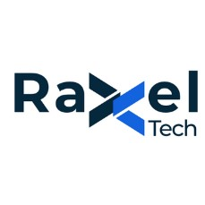

Ти мрієш створювати розумні машини? Хочеш розібратися, як працює автопілот, або просто любиш кодити та паяти? Запрошуємо школярів та студентів на масштабне змагання Karazin.Robotics! Це твій шанс прокачати Hard Skills, зануритися в атмосферу університетського драйву та позмагатися за звання найкращого робототехніка.

# **Календар події**

Змагання проходитиме у три етапи:

**ЕТАП 1: Відбірковий (Online)** — Січень – 24 березня 2026

* Що робимо: Дивимось воркшопи, виконуємо завдання вдома, реєструємось.

**ЕТАП 2: Школа робототехніки** — 24 – 30 березня 2026

* Що робимо: Інтенсивне навчання, розбір електроніки та сенсорів.

**ЕТАП 3: Грандіозний Фінал** — 11 квітня 2026

* Що робимо: Запускаємо роботів у лабіринті та визначаємо переможців.

# **Деталі та завдання етапів**

### **ЕТАП 1. Відбірковий (Online)**

**Дедлайн подачі рішень:** 24 березня 2026 року.

Ми підготували для вас два відео-воркшопи. Ваша мета — переглянути лекції та виконати завдання, які стануть вашим "квитком" у наступний етап.

**Увага!** Завдання є унікальними для кожного учасника. Вхідні параметри прив’язані до твоєї дати народження (день та місяць).

**Важливо: ви можете надсилати форму з будь-яким рівнем готовності.**

##### **Воркшоп 1.1: Знайомство з Arduino (Емулятор)**

Навчися створювати "мозок" для робота, не виходячи з дому.

<NewsYouTube id="https://youtu.be/pusEv7w7i7Q" title="Karazin Robotis 2026 workshops 01" />

1. **Подивись відео-лекцію:** про роботу з емулятором Arduino
2. **Збери схему:** Створи ланцюг зі світлодіодом.
3. **Напиши код:** Реалізуй керування яскравістю та логічну умову спрацювання (наприклад, включення при певному значенні).
4. **Надіслати результати:** Доповніть форму вашим розв'язанням

[Відправити роботу](https://csai.karazin.ua/event-registration?target=robotics2026)

##### **Воркшоп 1.2: Фізика робототехніки**

Справжній інженер має розуміти фізику руху.

<NewsYouTube id="https://youtu.be/MUPHdWrLa5E" title="Karazin Robotis 2026 workshops 02" />

1. **Подивись відео-лекцію:** про механіку робомашинки.
2. **Розв'яжи задачу:** Розрахуй, чи вистачить потужності двигуна та передавального числа редуктора, щоб потягнути вантаж.
3. **Унікалізація:** Маса вантажу або параметри двигуна залежать від місяця твого народження.
4. **Надіслати результати:** Доповніть форму вашим розв'язанням

[Відправити роботу](https://csai.karazin.ua/event-registration?target=robotics2026)

**Як здати роботу?** Заповни Google-форму за посиланням нижче. Тобі знадобляться:

* Скріншот екрану емулятора для першого завдання.
* Фотографія розв'язку задачі на папері для другого завдання.
* Твої контактні дані, щоб ми тебе запросили на участь в школі Робототехніки і фінал. 

<NewsPicture src="/src/assets/qr-code_karazin_robotics_extended.png" alt="Karazin.Robotics: Відправити роботу" />

[Відправити роботу](https://csai.karazin.ua/event-registration?target=robotics2026)

### **ЕТАП 2. Школа робототехніки (24-30 березня)**

Ті, хто успішно пройшов відбір, потрапляють до нашої Школи. Це серія лекцій та демонстрацій, де ми завершимо теорію. 

**Місце проведення:** безпечний простір Каразіна.

**Воркшопи відбудуться:** 24, 25, 26 березня з 10:00 до 13:40.

**Кожен день** — два воркшопи: о 10:10 та 12:00.

**Вільна практика:** 28 березня з 10:00 до 15:00 (попередній запис).

**Місце зустрічі:** центральний вхід північного корпусу Університету Каразіна (Свободи, 6), о 10:00.

**Мати з собою:** гарний настрій, бажання отримати знання, власний ноутбук (за бажанням, для зручності).

**Що будемо вивчати:**

* **Керування:** Як змусити колеса крутитися з потрібною швидкістю (ШІМ-сигнали).
* **Сенсори:** Вчимо робота "бачити" стіни (ультразвук), перешкоди (датчики) та розмітку (трекери).
* **Рівень PRO (для студентів):** Робота з камерою на базі ESP32 та основи комп'ютерного зору (Computer Vision).

### **ЕТАП 3. ФІНАЛ (11 квітня)**

<NewsPicture src="/src/assets/karazin-robotics-phase-3.png" alt="Karazin.Robotics: Етап 3" />

**Фінал:** Робомашинка має автономно пройти лабіринт.

[Регламент та правила робозмагань](https://drive.google.com/file/d/1I-ArBB8XKo_CfWe89zzKu2RekdjJujWc/view?usp=sharing)

Час показати, на що ти здатен!   

До зустрічі на Robofest 2026! Майбутнє будуємо ми!

.jpg>)

.jpg>)

**Організатор:** ННІ Комп’ютерних наук та штучного інтелекту

Партнери:

* ННІ Комп'ютерних наук та штучного інтелекту
* Кафедра комп'ютерних систем та робототехніки
* Інформаційний партнер INSCIENCE

* [Raxel Tech](https://www.raxeltech.com/)

Raxel Tech: [Інстаграм](https://www.instagram.com/raxel_tech?igsh=eWVubHFqYmM4ZTFt)\

* [Plasma-Spin-Energy](https://www.mpi-halle.mpg.de/plasma-spin-energy)

