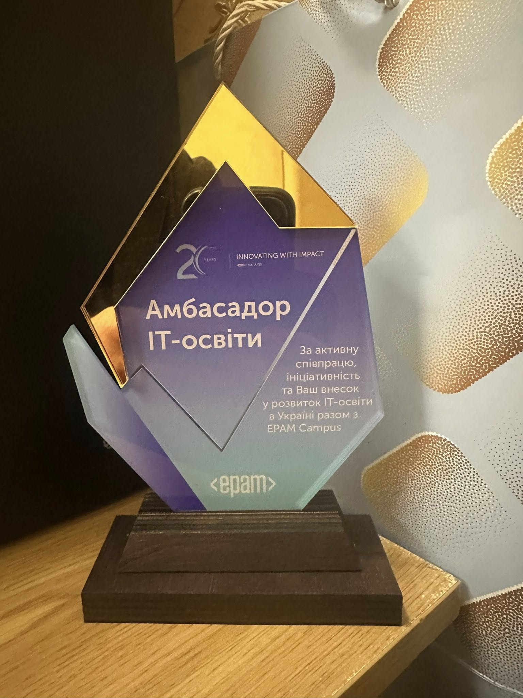

«Сьогодні мав честь отримати відзнаку «Амбасадор ІТ-освіти» від корпорації EPAM. Нагороду вручив Іван Міхєєв, керівник освітніх програм EPAM у східному регіоні України.

Для мене ця відзнака — не просто особиста нагорода, а підтвердження того, що зусилля нашої команди ННІ комп'ютерних наук та штучного інтелекту ХНУ імені В. Н. Каразіна рухають ІТ-освіту у правильному напрямку. 

EPAM високо оцінила наші досягнення та внесок у розвиток освіти, а також підтримала важливу ініціативу — участь у створенні бомбосховища інституту, що стало вагомим прикладом корпоративної соціальної відповідальності. 

EPAM є нашим ключовим партнером та стейкхолдером. Коли твій внесок помічає такий потужний гравець ринку, це дає неймовірний імпульс працювати ще активніше.

Щиро дякую EPAM Campus та особисто Івану Міхєєву за довіру, підтримку та спільні ініціативи. Попереду ще більше спільних проєктів, інновацій та можливостей для наших студентів!» 

— Дмитро Узлов, Директор ННІ комп’ютерних наук та штучного інтелекту.

