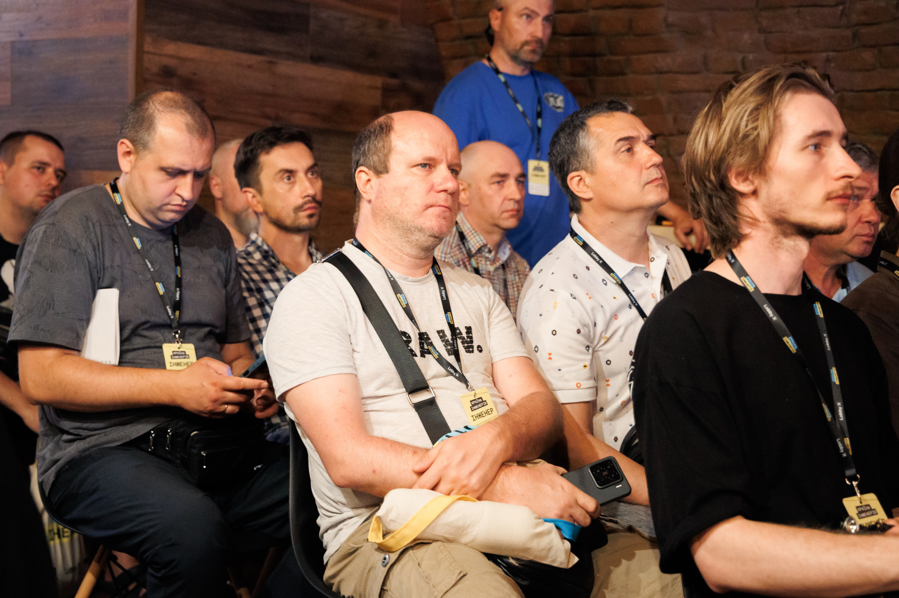

13 червня 2026 року в Харкові відбулася важлива подія для технологічної та наукової спільноти України — національний захід «Країна інженерів». До обговорення найсучасніших викликів інженерії долучився Максим Михайлович Хруслов, завідувач кафедри комп'ютерних систем та робототехніки навчально-наукового інституту комп'ютерних наук та штучного інтелекту Харківського національного університету імені В.Н. Каразіна.

Захід «Країна інженерів» має на меті зібрати інтелектуальне ядро держави: досвідчених інженерів, науковців та конструкторів для масштабування miltech-рішень. Під час події учасники ділилися експертизою та обговорювали створення практичних технологій, здатних докорінно змінити оборонну спроможність нашої країни та перетворити теоретичні розрахунки на реальну перевагу на полі бою.

Однією з ключових тем для обговорення став критичний дефіцит кваліфікованих інженерних кадрів. Як свідчать останні галузеві дослідження, український оборонно-промисловий комплекс (ОПК) наразі росте значно швидше, ніж ринок праці встигає готувати нових інженерів. Сьогодні 100% defense-tech компаній планують найм нових фахівців, проте стикаються з серйозним бар'єром — нестачею кадрів.

Найбільш затребуваними на сьогодні є:

* Інженери-конструктори.
* Інженери з електроніки та вбудованих систем.
* Розробники програмного забезпечення.

У цьому контексті участь представників академічної спільноти, зокрема ХНУ імені В.Н. Каразіна, є надзвичайно актуальною. Дослідження показують, що 48% оборонних компаній вбачають вирішення кадрової проблеми саме у кращій взаємодії з університетами. Кафедра комп'ютерних систем та робототехніки, яку очолює Максим Хруслов, безпосередньо готує фахівців саме з тих напрямків, які є критично необхідними для інноваційного розвитку сектору: від автоматизації та мехатроніки до зв'язку та штучного інтелекту.

У рамках заходу також відбувся пітчинг інноваційних ідей та демонстрація прототипів, де найкращі проєкти могли залучити фінансування з грантового фонду розміром до 100 000 доларів США. Україна вже має потужні приклади успішних інжинірингових стартапів світового рівня, які підтверджують наш колосальний потенціал: наприклад, компанія Esper Bionics, що створює роботизовані протези на основі штучного інтелекту, або стартап Kurs Orbital, який розробляє рішення для орбітального обслуговування супутників.

Участь Максима Михайловича Хруслова у національній серії «Країна інженерів» підкреслює прагнення Харківського національного університету імені В.Н. Каразіна бути в авангарді сучасних технологічних процесів, адаптувати навчальні програми до реальних потреб ринку та об'єднувати фундаментальну науку з потребами оборонної індустрії України.

Lobby X [https://thelobbyx.com/](https://thelobbyx.com/)

Міністерство Оборони України [https://mod.gov.ua/](https://mod.gov.ua/)

Сайт заходу [https://miltech.thelobbyx.com/](https://miltech.thelobbyx.com/)

