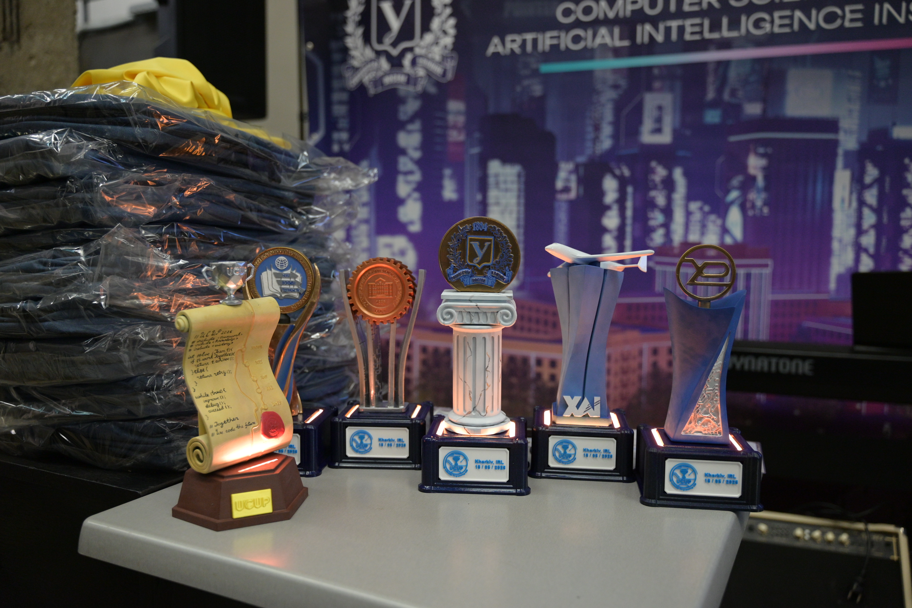

Харківський національний університет імені В. Н. Каразіна взяв активну участь у першому масштабному міжуніверситетському змаганні з програмування та креативних ІТ-дисциплін — University Programming Cup 2026 (UCUP). Студенти університету продемонстрували високий рівень підготовки та командної роботи протягом усієї серії івентів.

Захід тривав з 17 квітня по 18 травня 2026 року у форматі виключно офлайн на базі безпечних просторів університетів Харкова. У змаганнях взяли участь близько 100 студентів у складі команд від 7 закладів вищої та фахової освіти міста.

#### Ключові івенти сезону

* **19 квітня** — Prompt Evolution (змагання з prompt engineering та роботи з нейромережами, партнер — NEAR.AI);
* **26 квітня** — Game Jam (5-годинний інтенсив зі створення комп’ютерних ігор);
* Командні технічні батли та кіберспортивні турніри;
* **16–17 травня** — Фінал у форматі класичної командної олімпіади з алгоритмічного програмування (команди по 3 особи, 5 годин роботи, стиль ICPC).

#### Організатори та партнери

Організаторами виступили Харківський національний університет імені В. Н. Каразіна, Національний технічний університет «Харківський політехнічний інститут» та Молодіжне товариство Q-Bit. Значний внесок у проведення змагань зробили студенти-організатори з університетів-учасників.

Партнерами стали Харківський ІТ Кластер, NEAR.AI, Rozetka, NIX, Balex Group та інші ІТ-компанії Харкова.

### Результати командного заліку університетів

1. Національний технічний університет «Харківський політехнічний інститут» (команда KhPI\_Potuzhnist) — 4 золоті, 5 срібних, 7 бронзових медалей.
2. Харківський національний університет імені В. Н. Каразіна (команда AbstractTeamFactoryProvider) — 2 золоті, 3 срібні, 9 бронзових медалей.
3. Харківський національний економічний університет імені Семена Кузнеця (команда Hello World) — 1 золота, 1 срібна, 2 бронзові медалі.

Серед інших відзначених команд — RedBarrel (ХАІ) та «Шаурма (з малиною)» (ХНУРЕ), які здобули нагороди на окремих етапах.

Детальні результати на сайті: [https://ucup.org.ua/standings?lang=ua](https://ucup.org.ua/standings?lang=ua)

### Результати ХНУ ім. В.Н. Каразіна

Наш університет посів друге місце в загальному заліку університетів. Більшість команд від університету представляв **ННІ комп’ютерних наук та штучного інтелекту** (ННІ КН та ШІ).

Водночас команди з інших факультетів також зробили вагомий внесок у загальний результат Каразіна.

Крім того, 6 студентів-добровольців з ННІ КН та ШІ брали активну участь в організації івенту.

Усі переможці та призери отримали сертифікати, призи та мерч від партнерів. 

UCUP 2026 став першою в історії Харкова міжуніверситетською серією змагань такого масштабу. Захід продемонстрував високий рівень студентського програмування, забезпечив нетворкінг між вишами та ІТ-компаніями і створив основу для щорічних сезонів.

Церемонія закриття відбулася 18 травня 2026 року в арт-просторі YermilovCentre.

