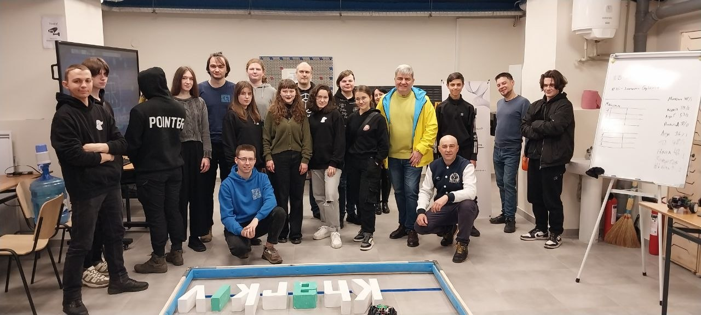
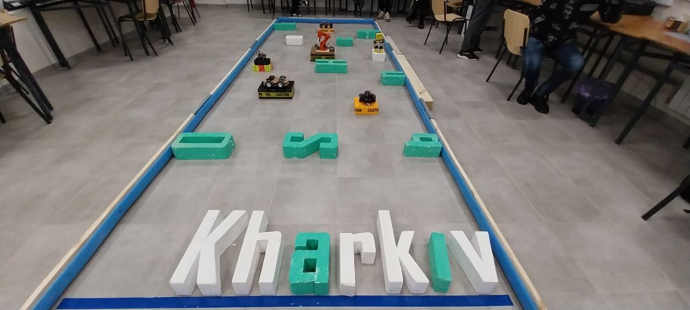
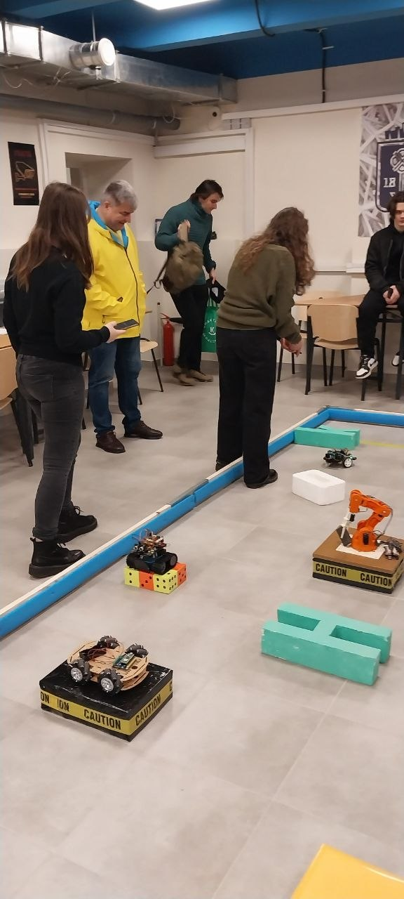
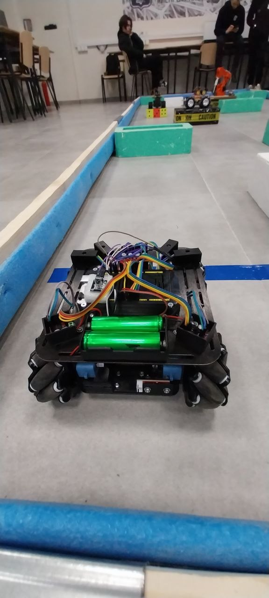
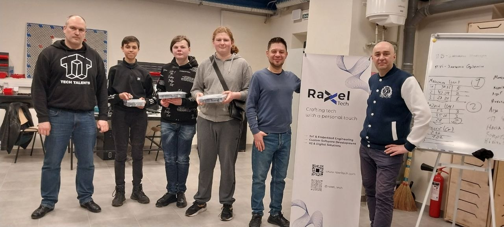
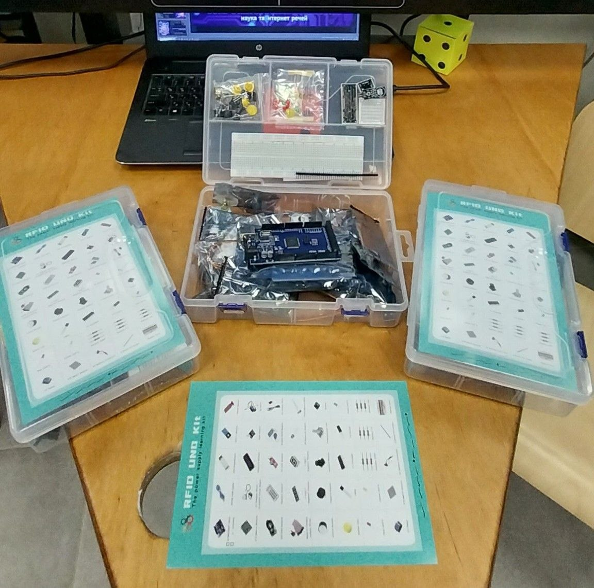

11 квітня 2026 року в безпечному просторі Харківського національного університету імені В.Н. Каразіна відбувся фінал відкритого турніру **Karazin.Robotics**, організований за ініціативи ННІ комп’ютерних наук та штучного інтелекту. Захід об’єднав талановиту молодь, яка захоплюється робототехнікою, програмуванням та сучасними технологіями.

Змагання урочисто відкрили директор інституту Дмитро Узлов та завідувач кафедри комп’ютерних систем та робототехніки Максим Хруслов, побажавши учасникам натхнення, чесної боротьби та яскравих перемог.

Турнір складався з двох етапів. У першому етапі свої навички демонстрували школярі, які керували робомашинками на базі Arduino Mega за допомогою інфрачервоного пульта, намагаючись якнайшвидше пройти складний лабіринт. Атмосфера була напруженою, адже кожна секунда мала значення. Результати тренувальних спроб оголошував голова журі, заступник директора інституту Олексій Турута.

Другий етап об’єднав студентів, які продемонстрували глибші знання у сфері програмування та автоматизації, створюючи алгоритми автономного руху робомашинок. Учасники показали високий рівень підготовки, інженерного мислення та креативного підходу до розв’язання технічних задач.

За підсумками змагань переможцями стали:

* **серед школярів:**
  І місце — Максим Берестровський
  ІІ місце — Андрій Цурков
* **серед студентів:**
  І місце — Олексій Кочесоков

Усі переможці та призери були нагороджені цінними подарунками від ІТ-компанії Raxel Tech.

Турнір **Karazin.Robotics** вкотре довів, що сучасна молодь має великий потенціал у сфері технологій, а подібні заходи є важливою платформою для розвитку інженерних навичок, обміну досвідом та натхнення для майбутніх досягнень.

