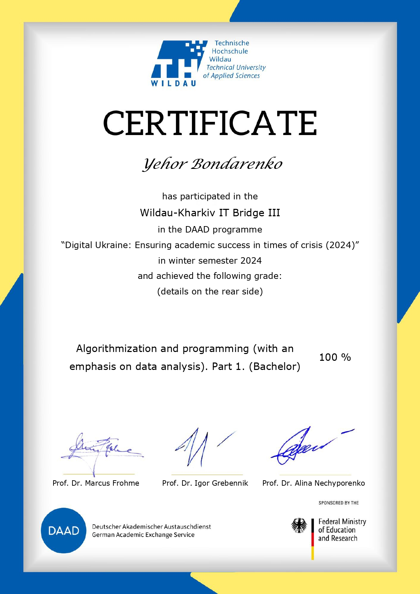
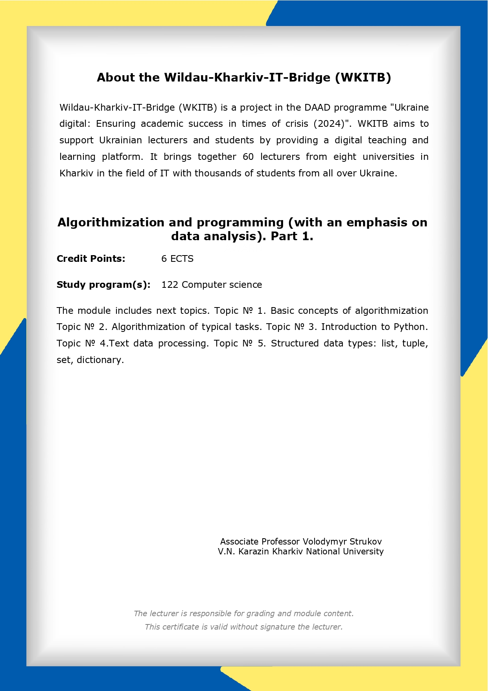

Студенти 1-го курсу ННІ комп’ютерних наук та штучного інтелекту, які навчаються за спеціальністю 122 «Комп’ютерні науки» та викладачі кафедри математичного моделювання та аналізу даних в осінньому семестрі 2024/2025 навчального року прийняли участь у міжнародній програмі  академічних обмінів DAAD «Digital Ukraine: Ensuring Academic Success in Crisis (2024)» для студентів і викладачів українських вишів, які навчаються за напрямом IT в рамках проекту Wildau-Kharkiv IT Bridge (WKITB). Проект запроваджений німецькою службою академічних обмінів DAAD та Технічним університетом прикладних наук Вільдау.

Студенти, які успішно завершили навчання на платформі проєкту за дисципліною «Алгоритмізація та програмування (Python)», отримали сертифікати міжнародного зразка, які актуальні в країнах Європейського Союзу.

