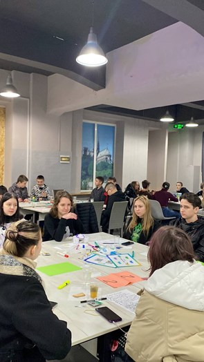
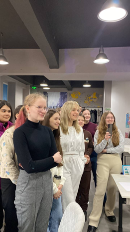

Харківський національний університет імені В. Н. Каразіна запрошує тебе стати частиною інноваційного середовища.

“Шлях в IT” — це твій перший крок до успішної кар'єри у сфері технологій. На тебе чекають виступи провідних експертів галузі, знайомство з найсучаснішими технологіями та практиками, а також інтерактивні події, які допоможуть обрати свій напрямок у світі IT. 

Ця подія має формат інтерактивних лекцій та майстер-класів, що допоможуть учасникам глибше зануритися у світ інформаційних технологій.

На тебе чекають такі івенти:

* Початок подорожі (15.02.2025)
  Дізнайся про основні напрямки в IT та кар'єрні можливості, які відкриваються перед тобою.
* Сортувальний капелюх (01.03.2025)
  Розкриття секретів різних IT-професій, зокрема DevOps, Software Architect та інших.
* Секрети замку Каразіна (22.02.2025)
  Таємниці операційних систем: розбираємо магію роботи замку IT.
* Вежа Логікус (08.03.2025)
  Досліджуємо важливість аналізу даних у світі технологій.
* Вежа Механікус (15.03.2025)
  Налагодження взаємодії з автоматизованими системами – повертаємо порядок у замок IT.

Кожен івент розпочинається о 11:00 за Києвом, а тематика заходів натхненна магічною атмосферою, що додає інтерактивності та залучає учасників у навчальний процес.Учасники кампанії “Шлях в IT” не лише зануряться у світ сучасних технологій, а й отримають цінні можливості для подальшого розвитку.

* Сертифікати учасника, що підтверджують здобуті знання та навички.
* Нові знайомства з однодумцями, експертами та представниками IT-індустрії.
* Практичні навички, отримані під час інтерактивних заходів.
* Мотивацію та розуміння власного шляху у сфері IT.
* Можливість долучитися до освітніх програм ННІ комп’ютерних наук та штучного інтелекту.

Якщо ти цікавишся технологіями, хочеш обрати майбутню професію або розширити свої знання – ці події саме для тебе! 

Обирай ННІ комп’ютерних наук та штучного інтелекту – і будь на крок попереду у світі IT!
