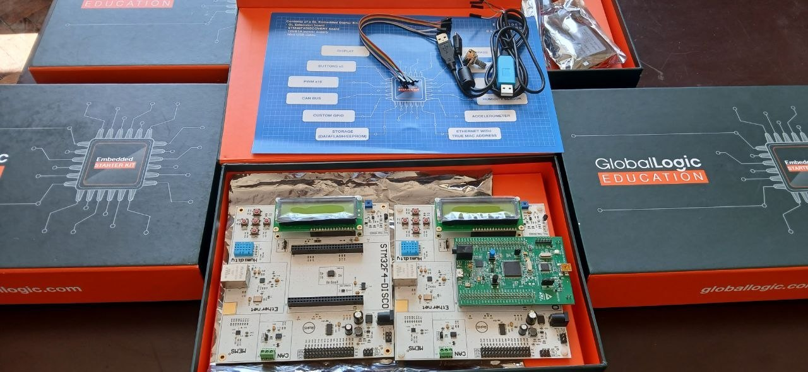
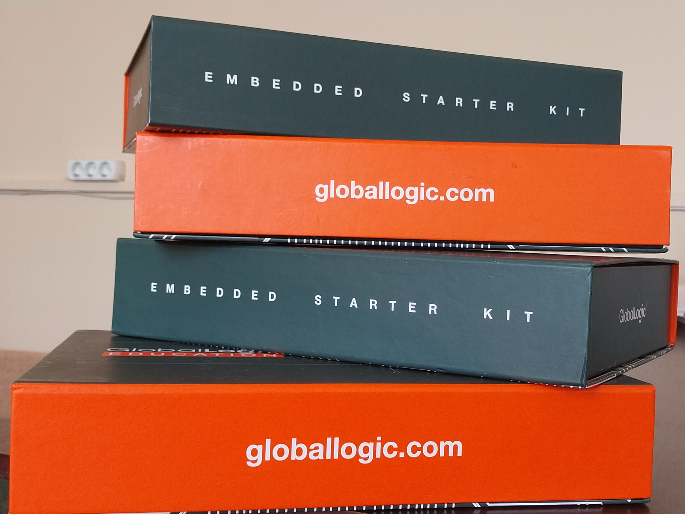

Із 19 липня в Україні стартував один із ключових етапів вступної кампанії — подання заяв до закладів вищої освіти. Протягом двох тижнів абітурієнти обиратимуть майбутню спеціальність і заклад освіти, що визначатиме їхній професійний розвиток у найближчі роки.

У сучасних умовах особливого значення набуває співпраця університетів із роботодавцями, які долучаються до формування освітніх програм відповідно до актуальних потреб ІТ-ринку. Одним із прикладів такого партнерства є взаємодія ТОВ «ГЛОБАЛЛОДЖИК УКРАЇНА» та Харківського національного університету імені В. Н. Каразіна.

Компанія системно підтримує розвиток української ІТ-освіти та бере участь у підготовці майбутніх фахівців. У межах співпраці з навчально-науковим інститутом комп’ютерних наук та штучного інтелекту за участю експертів GlobalLogic було вдосконалено STEM-напрям підготовки, а також проведено рецензування нової освітньо-наукової магістерської програми «Кіберфізичні системи та робототехніка» за спеціальностями «Комп’ютерна інженерія» та «Автоматизація, комп’ютерні технології та робототехніка».

Залучення представників ІТ-індустрії до оновлення освітніх програм дає змогу адаптувати навчальний процес до сучасних вимог глобального ринку інформаційних технологій та забезпечити студентів актуальними знаннями й практичними навичками.

Окрім експертної підтримки, компанія долучилася до зміцнення матеріально-технічної бази університету. GlobalLogic передала навчально-науковому інституту сучасні інженерні комплекти для розробки та налагодження мікроконтролерів сімейства STM32. Обладнання вже інтегрується в лабораторний фонд і використовується в освітньому процесі студентами різних курсів. Зокрема, комплекти StarterKit v1.2 та плати STM32F407G-DISC1 допомагають майбутнім інженерам проводити наукові дослідження, відпрацьовувати практичні навички та реалізовувати власні інноваційні проєкти.

Сьогодні успішний університет — це не лише сучасні освітні програми, а й тісна взаємодія з провідними роботодавцями.

